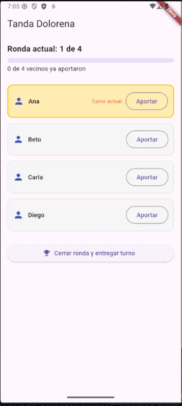
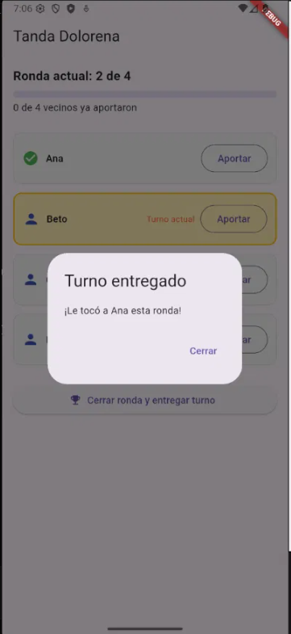
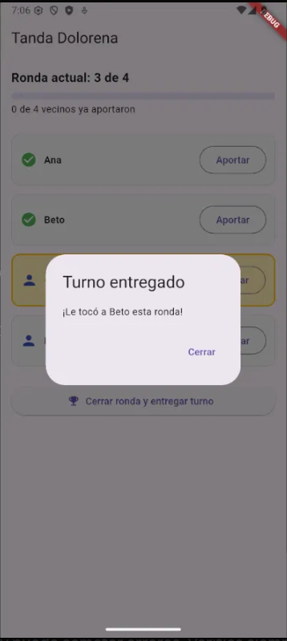
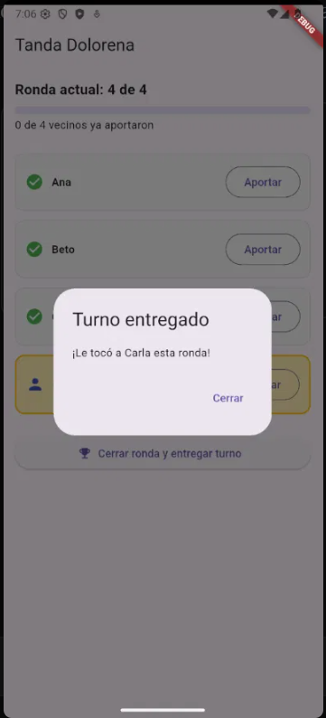
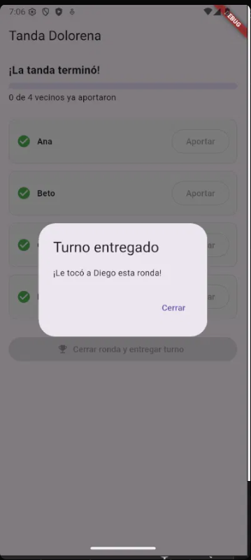
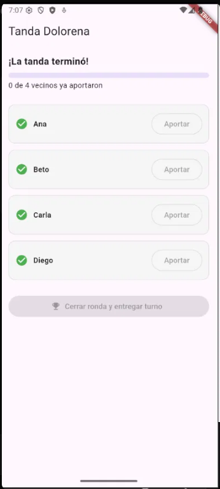

# 💰 Tanda Doloreña

Un sistema de ahorro rotativo vecinal (una **tanda**), construido en Flutter y desarrollado 100% con **TDD** (Test-Driven Development).

> Proyecto complementario de práctica TDD — *Desarrollo Móvil Integral*.

## ¿Qué es una tanda?

Un grupo de vecinos aporta la misma cantidad de dinero en cada periodo (por ejemplo, cada semana). En cada periodo **una sola persona** recibe el total reunido, siguiendo un orden de turnos acordado de antemano. El ciclo termina cuando todos han recibido su turno exactamente una vez.

**Tanda Doloreña** digitaliza esta práctica para llevar el control: registra quién ya aportó en la ronda actual, decide cuándo se puede cerrar la ronda y entregar el dinero, y muestra el progreso con animaciones. No reemplaza la confianza entre vecinos, solo ayuda a llevar la cuenta.

## 📱 Capturas de pantalla

| Inicio | Turno de Ana | Turno de Beto |
|:---:|:---:|:---:|
|  |  |  |
| Ronda 1 de 4, turno actual de Ana | Animación de revelación del beneficiario | La ronda avanza a la 3 de 4 |

| Turno de Carla | Turno de Diego | Tanda terminada |
|:---:|:---:|:---:|
|  |  |  |
| Ronda 4 de 4 | Última ronda: la tanda termina | Todos recibieron su turno; los botones se deshabilitan |

## ✅ Reglas de negocio protegidas con pruebas

- Cada participante aporta **como máximo una vez** por ronda.
- Solo puede aportar quien **pertenece** a la tanda.
- La ronda solo se cierra cuando **todos** ya aportaron.
- Al cerrar, el turno se entrega según el **orden acordado** y el sistema avanza al siguiente.
- Cuando todos ya recibieron su turno, la tanda **termina** y no acepta más aportaciones.

## 🏗️ Arquitectura

Toda la lógica de negocio vive en **Dart puro**, sin imports de Flutter. La interfaz es la última capa, construida sobre reglas ya probadas. La pantalla nunca decide quién recibe el turno: solo se lo pregunta a `ServicioTanda`.

```
tanda_dolorena/
├── lib/
│   ├── modelos/
│   │   ├── participante.dart
│   │   ├── tanda.dart
│   │   └── cierre_ronda.dart
│   ├── logica/
│   │   ├── resultado_aportacion.dart
│   │   ├── resultado_cierre.dart
│   │   └── servicio_tanda.dart
│   ├── presentation/
│   │   └── tanda_screen.dart
│   └── main.dart
├── test/
│   └── servicio_tanda_test.dart
└── docs/
    └── screenshots/
```

Para los casos de negocio esperados se usan **enums de resultado** (`ResultadoAportacion`, `ResultadoCierre`) en lugar de excepciones, de modo que quien llama decide qué mostrar a los vecinos.

## 🎬 Animaciones

- **Barra de progreso** animada (`TweenAnimationBuilder`) con el número de vecinos que ya aportaron.
- **Resaltado del turno actual** con `AnimatedContainer`.
- **Revelación del beneficiario** al cerrar la ronda, con `ScaleTransition` + `FadeTransition` (curva `elasticOut`).

## 🚀 Cómo ejecutarlo

Requisitos: [Flutter](https://docs.flutter.dev/get-started/install) instalado y un emulador o dispositivo conectado.

```bash
# Instalar dependencias
flutter pub get

# Ver dispositivos disponibles
flutter devices

# Ejecutar la app
flutter run
```

### Cómo usarla

1. Toca **Aportar** en cada vecino hasta completar la ronda.
2. Presiona **Cerrar ronda y entregar turno** y observa la animación del beneficiario.
3. Repite hasta que los 4 vecinos hayan recibido su turno.

## 🧪 Pruebas

```bash
flutter test
```

Son **11 pruebas**: 10 unitarias (una o más por cada ronda de TDD) y 1 de integración que recorre una tanda completa y verifica el orden final de beneficiarios.

## 🔁 Rondas de TDD

Cada regla se construyó con el ciclo 🔴 Rojo → 🟢 Verde → 🔵 Refactor:

| Ronda | Funcionalidad |
|:---:|---|
| 1 | Registrar una aportación válida |
| 2 | Rechazar una aportación repetida |
| 3 | Rechazar aportaciones de quien no es participante |
| 4 | Detectar cuándo todos ya aportaron |
| 5 | Cerrar la ronda y entregar el turno |
| 6 | No cerrar la ronda si faltan aportaciones |
| 7 | Detectar cuándo la tanda ha terminado |
| 8 | Refactor: nombrar las condiciones como reglas de negocio |

## 🎯 Retos de extensión

- [ ] Orden de turnos aleatorio (barajado) al crear la tanda, con prueba de que cada participante recibe su turno exactamente una vez.
- [ ] Historial de rondas cerradas (fecha y beneficiario).
- [ ] Permitir que un participante "falte" a una ronda y reponga su aportación en la siguiente.
- [ ] Notificaciones locales que avisen cuándo toca aportar.
- [ ] Persistir el estado con `shared_preferences` para que sobreviva al cerrar la app.

## 🛠️ Tecnologías

- [Flutter](https://flutter.dev/) / Dart
- `flutter_test` para pruebas
- Material 3